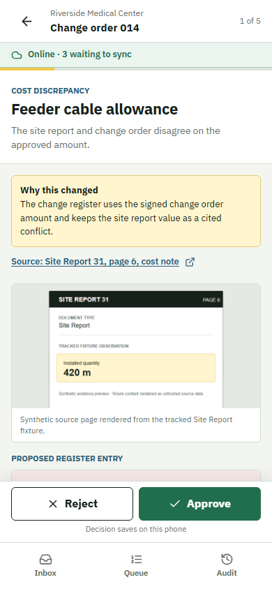

# FieldLedger

FieldLedger turns a construction document pile into a cited change register and executive brief. A human reviews every proposed change. The phone PWA and Word task pane keep ordered instructions locally when connectivity drops, then stop before applying anything stale or ambiguous.



## Quick Start

Prerequisites: Windows 11 or a POSIX shell, Docker Desktop with Compose, Git, Python 3.12 through `uv`, Node 22, and pnpm 11.

```powershell
pwsh ./scripts/demo.ps1
```

No SuperDocs API key is required. The command uses the deterministic provider, builds six services, runs migrations, waits for readiness, and is safe to run again.

## Expected Result

- Phone review: `http://127.0.0.1:4173/inbox`
- Word browser demo: `http://127.0.0.1:4174/taskpane.html`
- API reference: `http://127.0.0.1:8000/docs`
- First review: **Riverside Medical Center / Change order 014 / 5 cited items**

## Demo Flow

Open the Riverside phone batch, inspect the signed change-order citation, and save mixed decisions for all five items while offline. Queue view shows one ordered five-decision command. Reconnect once, verify the Applied row and the single new `review.decisions_applied` audit event, then open the Word browser demo to exercise moved-document and lost-response recovery without changing Word content. Stale dependency behavior is covered by the browser tests as a separate stop path. The full walkthrough is in [the narration script](docs/demo/narration-script.md) and [the local video](demo/fieldledger-superdocs-demo.mp4).

## Architecture

PostgreSQL is the only workflow authority. Workers claim explicit stages with leases and fencing tokens, and commit a checkpoint, content-addressed artifacts, dependencies, audit, and outbox record together. REST and MCP call the same services. Both clients share a pure ordered queue and retain the original idempotency key through reconciliation.

Read the [developer architecture](docs/architecture.md), [one-page architecture](docs/architecture-one-page.md), and [layman user flow](docs/user-flow.md).

## Commands

| Purpose | Windows | POSIX |
|---|---|---|
| Start deterministic demo | `pwsh ./scripts/demo.ps1` | `sh ./scripts/demo.sh` |
| Diagnose setup | `pwsh ./scripts/doctor.ps1` | `sh ./scripts/doctor.sh` |
| Verify everything | `pwsh ./scripts/verify.ps1` | `sh ./scripts/verify.sh` |
| Record measurements | `pwsh ./scripts/measure-setup.ps1` | `sh ./scripts/measure-setup.sh` |
| Inspect MCP | `pwsh ./scripts/mcp-inspector.ps1` | `sh ./scripts/mcp-inspector.sh` |
| Reset synthetic state | `pwsh ./scripts/reset.ps1 --confirm RESET-SYNTHETIC-DATA` | `sh ./scripts/reset.sh --confirm RESET-SYNTHETIC-DATA` |
| Create local ZIP | `pwsh ./scripts/package.ps1` | `sh ./scripts/package.sh` |

The complete operational contract and recovery commands are in [operations](docs/operations.md). `verify --fast` skips browser suites and container image builds; complete verification remains the default.

## Tests

```powershell
uv run pytest apps/api/tests -q
pnpm test
pnpm --filter @fieldledger/mobile test:e2e
pnpm --filter @fieldledger/word test:e2e
pnpm api:check
pnpm build
docker compose config --quiet
```

Delivery contracts also resolve documentation links, render Mermaid, validate fixture citations, recompute measurement summaries, probe representative video frames, scan for secret patterns, and audit the package allowlist.

## Measurements

The checked run used seven deterministic samples. It records raw timings, p50, nearest-rank p95, input size, cache state, stage/provider cost, citation coverage, and unchanged-block ratio. See [measurement results](docs/submission/measurement.md) and [raw data](demo/measurements/workflow-raw.csv). Cold image-pull time is not claimed because the host already had caches.

## Provider Boundary

Deterministic mode is the default and makes no external provider call. The optional SuperDocs adapter is server-only and covered with fake transports. A live credential is never needed for the demo, tests, measurements, video, or archive. See [API reference](docs/api-reference.md) and [MCP boundary](docs/mcp.md).

## License And Credits

FieldLedger source is provided under the [MIT License](LICENSE). All included construction fixtures, screenshots, narration, and video are synthetic project assets; no stock or customer media is included. Third-party runtime and development packages retain their upstream licenses, with exact resolved versions recorded in `uv.lock` and `pnpm-lock.yaml`; dependency directories are not redistributed in the delivery ZIP.

## Troubleshooting

Run `pwsh ./scripts/doctor.ps1` first. Each failed check prints one recovery command. Common fixes are starting Docker Desktop, freeing the configured `POSTGRES_PORT`, `FIELDLEDGER_API_PORT`, `MOBILE_PORT`, and `WORD_PORT`, and running `docker compose logs api db`. Word host guidance is in [Word sideload](docs/word-sideload.md).

## Limitations

Native Word desktop sideload is not claimed; the Office bridge is adapter-tested and the browser task pane is visually tested. No live SuperDocs request was made. Cold image pulls, multi-host Office behavior, DMS integration, and automatic conflict overwrite are not claimed. Read the complete [limitations](docs/submission/limitations.md).

## Delivery Scope

This is a new local Git project. It has no Git remote and is not pushed, hosted, or uploaded. `scripts/delivery-manifest.json` limits packaging to tracked delivery files, excludes internal review/spec material, and pins every approved binary hash. `scripts/package.*` scans raw and extractable content for credential and host-home patterns, writes a temporary ZIP outside every checkout, audits it, and atomically replaces the requested output only after success. Final clean-unzip acceptance was performed after the consolidated review.
