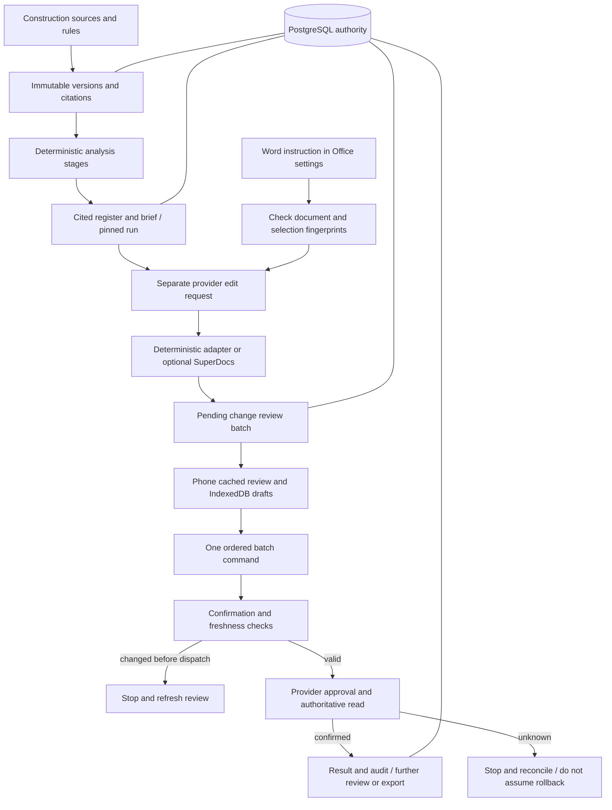

# FieldLedger Architecture: One Page

**Authority:** PostgreSQL; client storage is an offline buffer. **Worker recovery:** leases, fencing and transactional checkpoints. **Review safety:** authorization, reviewed dependency hashes, short-lived confirmation and request identity checks. **Provider:** no-key deterministic mode by default; optional SuperDocs credentials stay server-side. **Word:** proposal handoff, not automatic native write-back. **Unknown outcome:** reconciliation, not proof that nothing happened.

Read the [code map and transaction boundaries](architecture.md), [walkthrough](user-flow.md), and [known limitations](submission/limitations.md). The repository is published; hosting, live SuperDocs acceptance and native Word round-trip are not established by publication.
