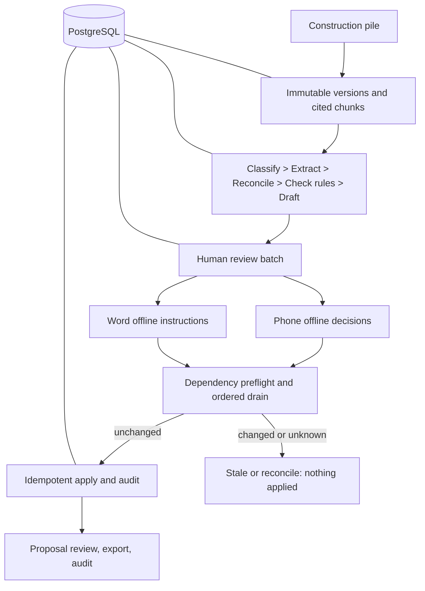

# FieldLedger Architecture: One Page

**Authority:** PostgreSQL, never browser storage. **Recovery:** leases, heartbeats, fencing tokens, idempotency keys, content-addressed outputs, and startup reclaim. **Trust:** exact citations and dependency vectors; source text cannot invoke tools. **Human gate:** UI confirmation is required for mutation. **Offline:** Dexie on phone and Office document settings in Word share one pure queue contract. **Provider:** deterministic/no-key by default; optional SuperDocs access stays server-only. **Delivery:** local Git and allowlisted ZIP, with no remote transfer.
