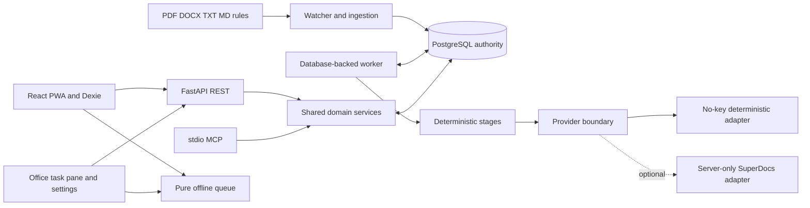
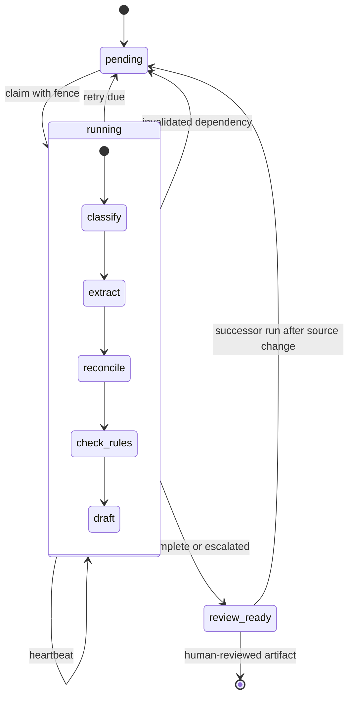

# Developer Architecture

## Components



PostgreSQL owns runs, immutable source versions, attempts, dependencies, artifacts, review batches, memberships, confirmation reservations, idempotency results, audits, and outbox records. UI stores improve offline ergonomics but never become server authority.

## Workflow And Failure Paths



Each claim takes a lease and monotonically increasing fencing token. A late worker cannot commit with an old token. A stage commit writes the checkpoint, content-addressed artifact blocks, dependency edges, audit event, and transactional outbox in one transaction. Startup reclaims expired work. Completed stages with identical inputs are skipped.

## Data And Dependency Flow

The run manifest pins target document version, every source version, rule version, policy/prompt hash, and proposal version. Artifact blocks include a canonical dependency vector. A changed source invalidates only successor lineage. Unaffected blocks remain byte-identical and their stages execute zero times.

```text
source bytes -> immutable version/hash -> parsed chunks/coordinates
  -> cited facts -> contradictions -> versioned findings
  -> content-addressed register/brief blocks -> review dependency vector
  -> human decision -> proposal/export -> audit
```

## Review And Security Boundary

Sessions are signed server-side and project membership is durable. Listing and mutation both enforce membership and role. Only the UI can mint a short-lived human confirmation. REST and MCP may relay the decision, but an agent cannot confirm its own proposal. Confirmation reservations and mutation fences bind actor, batch, payload, and idempotency key; timeout or lost response enters reconciliation.

## Offline Queues

The shared reducer uses `pending -> sending -> applied | stale | failed | reconciliation_required`. Drain is strictly ordered and stops at the first blocker. Phone commands live in IndexedDB. Word commands live in versioned `Office.context.document.settings` and are successful only after `saveAsync` succeeds. Before every send, Word recomputes document, body, selection, and bounded-context fingerprints. There is no force overwrite.

## Async Completion

Every new async phase clears stale status text. Success, `PreviewReady`, failed, cancelled, timeout, fetch/stream error, and post-mutation read error all clear loading. Follow-up reads are caught and show a recovery action. A reviewable provider state is a completed UI outcome, not an infinite spinner.

## Interfaces

- [API reference](api-reference.md)
- [MCP tools](mcp.md)
- [Operations](operations.md)
- [Word sideload](word-sideload.md)
- [Requirement matrix](submission/requirement-matrix.md)
