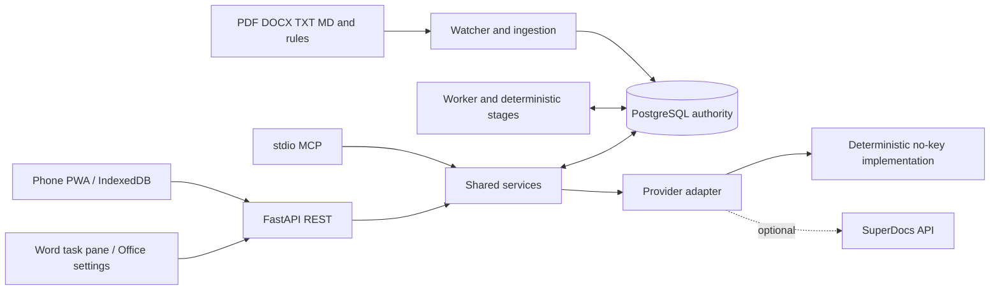
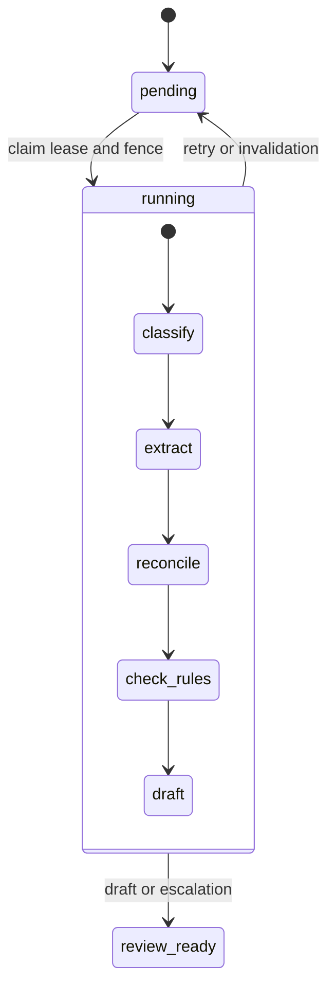

# Developer Architecture

FieldLedger has two connected workflows: **analyze source documents** and **review a provider's proposed edits**. The deterministic stage engine is not an LLM calling SuperDocs. A separate provider service starts an edit using a pinned, review-ready workflow run.

## Components and authority



[Compose](../compose.yaml) runs six containers: PostgreSQL, API, worker, watcher, mobile, and Word. API/worker/watcher use the same Python codebase. The [offline queue](../packages/offline-queue/src/drain.ts) is a shared TypeScript library compiled into both clients, not a seventh service. REST and MCP share authorization and domain services; MCP is FieldLedger's own server, not an invocation of SuperDocs MCP.

PostgreSQL owns source versions, runs, artifacts, review batches, membership, confirmations, command results, audit and outbox rows. IndexedDB and Office settings buffer client work; neither can authorize or prove an applied server result.

## Follow the code

Read top to bottom for one complete path; tests are linked in the [requirement matrix](submission/requirement-matrix.md).

| Step | Source | Responsibility |
|---|---|---|
| 1. Reproduce the example | [demo_service.py](../apps/api/src/fieldledger/services/demo_service.py) | Authenticate local demo actor, ingest fixtures, execute stages, start/poll provider editing and prepare review data |
| 2. Pin the inputs | [ingestion_service.py](../apps/api/src/fieldledger/services/ingestion_service.py), [workflow_service.py](../apps/api/src/fieldledger/services/workflow_service.py) | Parse immutable source versions and create a run with an input manifest |
| 3. Execute analysis | [worker.py](../apps/api/src/fieldledger/worker.py), [stages.py](../apps/api/src/fieldledger/agent/stages.py) | Claim work and run classify, extract, reconcile, check_rules, draft |
| 4. Store and invalidate | [repositories.py](../apps/api/src/fieldledger/persistence/repositories.py), [invalidation_service.py](../apps/api/src/fieldledger/services/invalidation_service.py) | Commit checkpoints and dependency-linked artifacts; schedule affected successor work |
| 5. Create provider proposals | [provider_service.py](../apps/api/src/fieldledger/services/provider_service.py) | Start editing against a pinned run; persist jobs and normalize pending changes into review batches |
| 6. Save phone decisions | [queueStore.ts](../apps/mobile/src/data/queueStore.ts) | Store drafts; atomically enqueue a command only after every batch item is decided |
| 7. Replay in order | [drain.ts](../packages/offline-queue/src/drain.ts), [queueSender.ts](../apps/mobile/src/api/queueSender.ts) | Request confirmation with server-side freshness checks, submit decisions, poll if needed, refresh state |
| 8. Enforce authority | [reviews.py](../apps/api/src/fieldledger/api/routes/reviews.py), [review_service.py](../apps/api/src/fieldledger/services/review_service.py) | Validate batch, actor, confirmation, dependencies and request identity; call approval and record results |
| 9. Export or hand off | [export_service.py](../apps/api/src/fieldledger/services/export_service.py), [Word replay.ts](../extensions/word/src/data/replay.ts) | Gate provider export; Word queues an instruction and links to proposal review without native write-back |

## Analysis lifecycle



A lease gives a worker time-limited ownership; a fencing token rejects a late commit from an older owner. Stage commit groups checkpoint, artifact blocks, dependencies, audit and outbox in one database transaction. The outbox records an event alongside its state change so a later publisher can deliver it; it is not a second workflow authority.

The [extractor](../apps/api/src/fieldledger/agent/extraction.py) recognizes typed text patterns. It is useful for the synthetic construction example, not a general-purpose document-understanding model. Source changes create successor work; dependency hashes allow unchanged results to be reused. Fixture measurements do not prove zero recomputation for arbitrary document changes.

## Identity and freshness

| Term | Meaning |
|---|---|
| Source version | Immutable ingested bytes and their hash, with parsed citation coordinates |
| Run manifest | Exact source, target, rules and policy/prompt inputs pinned for analysis |
| Artifact block | Content-addressed piece of the register or brief with dependency edges |
| Dependency vector | Sorted kind/key/hash entries for what was reviewed; its digest is a compact fingerprint |
| Review batch | Provider-proposed items plus reviewed dependencies; distinct from a workflow run |
| Command key | Stable client identity for a queued operation; exact request matching is also required |
| Confirmation | Short-lived, server-issued UI grant bound to actor, batch, dependencies and expiry |

The server compares current dependencies with the reviewed vector rather than trusting a client's online indicator. Membership and role checks protect reads and writes. A UI confirmation is a protocol boundary, not proof that a natural person clicked: production identity/session provisioning remains deployment work. MCP cannot mint its own confirmation. See [security limits](submission/limitations.md).

## Transaction and recovery boundary

```text
review command
  -> authorize + lock + validate confirmation/dependencies/request identity
  -> provider approval
  -> read provider state
  -> persist authoritative result + audit, or record an uncertain outcome
```

Database atomicity does **not** roll back a remote provider mutation. Calls and subsequent reads can fail after the remote side changed; reconciliation must distinguish that from a pre-dispatch rejection. Some guarded calls hold database locks while waiting on provider I/O, which limits throughput.

The queue stops behind stale, failed or uncertain earlier work. Phone polling accepts reviewable `PreviewReady` as well as completed outcomes and then refreshes authority; a new review round is not a finished document. Before dispatch, the phone persists the original confirmation in a separate IndexedDB submission record. Retries reuse that token, command key and decisions; concurrent tabs use the first saved token. Missing or mismatched records stop for verification rather than minting a replacement. Local fake-provider tests cover lost-response replay across database reopen; live-provider recovery is not claimed. See [remaining recovery limits](submission/limitations.md).

## Why these choices?

- PostgreSQL keeps durable state and transaction boundaries in one place instead of relying on browser memory or a second queue broker.
- Shared services keep REST and MCP subject to the same rules; shared queue logic keeps ordering consistent while each client handles its own storage.
- Deterministic fixtures make the no-key demonstration repeatable; they do not establish live provider fidelity or broad extraction quality.
- Fingerprints stop outdated instructions rather than force-overwriting newer content. A network timeout is not a rollback.

For user-visible behavior, read [end-to-end flow](user-flow.md). For payloads and commands, use [API reference](api-reference.md), [MCP](mcp.md), [operations](operations.md) and [Word sideload](word-sideload.md).
