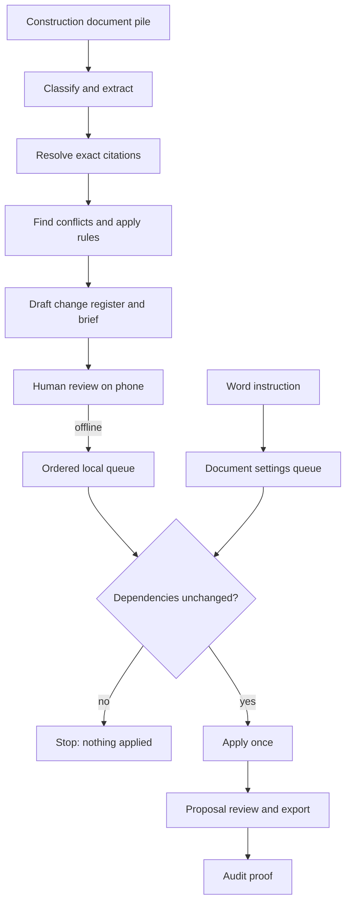
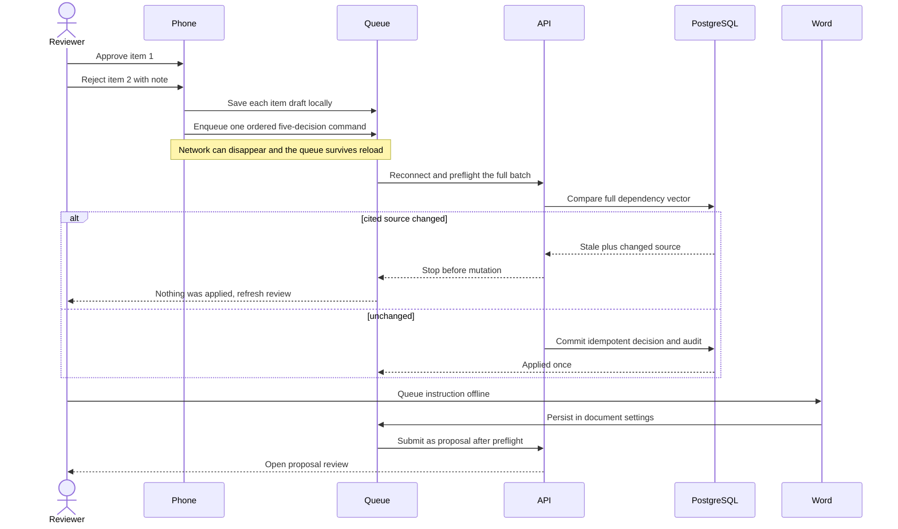

# FieldLedger User Flow

## In Plain Language

1. Put the contract, change order, field report, invoice, and review rules into one project.
2. FieldLedger reads each file, finds facts, and keeps an exact pointer back to the source page, paragraph, table cell, or line.
3. It reports contradictions and rule failures. It does not turn unsupported text into a fact.
4. A reviewer opens one change at a time on the phone, checks the evidence, and approves or rejects it. A rejection needs a note.
5. With no signal, decisions stay on that phone in order. The screen says **Saved on this phone**, not **Applied**.
6. On reconnect, FieldLedger checks every reviewed dependency before each command. If a cited source changed, the queue stops and nothing is applied.
7. A successful decision creates an audit record. Proposal work can be reviewed and exported only after human confirmation.
8. In Word, an instruction is stored inside document settings while offline. It creates a proposal on reconnect and never silently edits the document.

## End-to-End Flow

## Mixed Offline Decisions

Status words are evidence: **pending** means local, **sending** means one command is in flight, **applied** means the server confirmed it, and **needs reconciliation** means the result must be checked before continuing.
