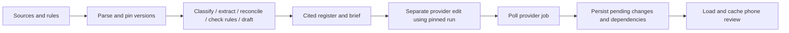
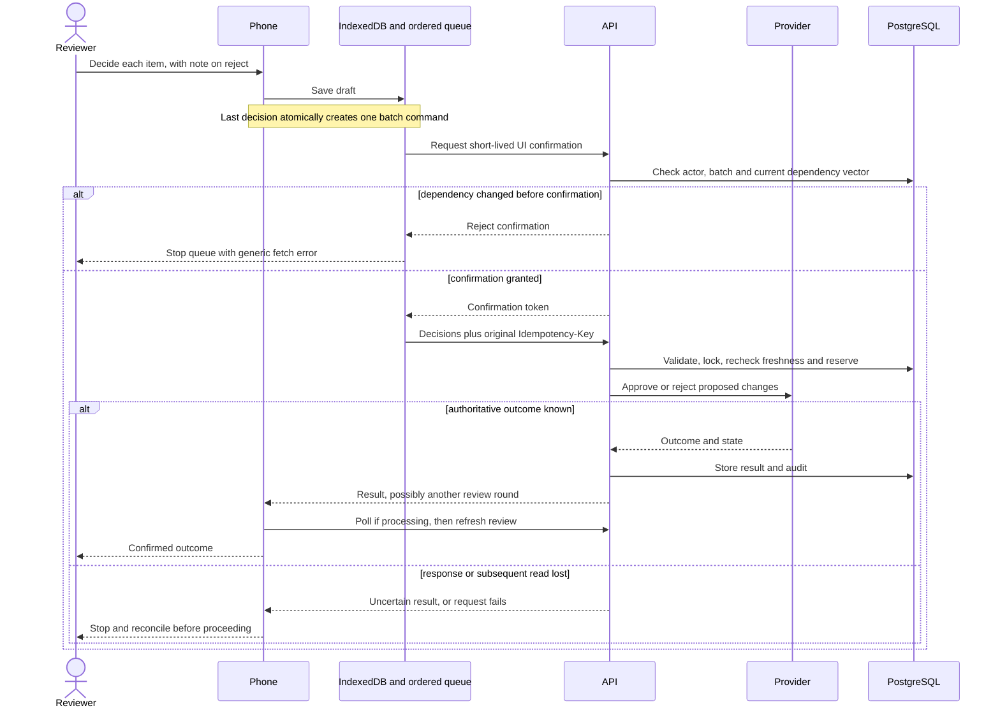

# FieldLedger: End-to-End Walkthrough

## What problem does it solve?

A construction reviewer has a contract, signed change order, site report and invoice that disagree. FieldLedger gathers cited facts into a change register and executive brief, then presents proposed document edits for a human decision. The phone supports review away from reliable connectivity. It distinguishes **saved locally** from **confirmed by the server**.

## Try the existing example

These are the intended steps from the original recording. The current checkout has a [contract PDF integrity blocker](submission/limitations.md) that must be resolved before a fresh seeded end-to-end run; this documentation update does not claim to fix it.

1. Run `pwsh ./scripts/demo.ps1` from the repository root. Use [operations](operations.md) for prerequisites, diagnosis and safe reset commands.
2. Open `http://127.0.0.1:4173/inbox` while online and load **Riverside Medical Center / Change order 014**. Loading caches the review data; offline mode cannot fetch a never-loaded review.
3. Inspect the five items. The feeder allowance moves from **$42,500 to $47,250** with the signed change-order citation; the conflicting site report remains evidence to inspect. The synthetic oracle excludes an unsupported savings claim.
4. Go offline. Approve four items and reject item 2 with a note. Each choice saves a draft. Once all five are decided, the phone creates **one ordered five-decision command**, not five independent approval requests.
5. Reload while offline and inspect the queue. IndexedDB should restore saved work. This demonstrates reload persistence, not a guarantee against browser storage deletion or every mobile OS eviction policy.
6. Reconnect. On the successful deterministic path, the queue shows Applied and the audit contains one new `review.decisions_applied` event. A repeat online event should not send an already-applied command again.
7. Try the optional Word browser task pane at `http://127.0.0.1:4174/taskpane.html`. It queues instructions in document settings, checks document/selection fingerprints, and offers proposal review. It does not insert approved text into native Word ranges.

The [video](../demo/fieldledger-superdocs-demo.mp4) and [narration](../demo/narration.txt) show the original deterministic demonstration. Their local-only packaging statements describe that earlier recording, not current publication. Read [limitations](submission/limitations.md) before interpreting recovery scenarios as universal guarantees.

## From source files to review

The demo seed connects these steps through real local services. Normal analysis produces artifacts first; it does not itself call SuperDocs. Provider lifecycle work uploads/starts/polls separately and creates the pending-change batch. The default provider is deterministic, so no external API call is needed. The [architecture code map](architecture.md) points to each implementation.

## Offline decisions through confirmation

This shows the successful and safety paths, not a claim that every retry resolves automatically. The phone does not send a separate freshness-preflight request: confirmation checks the dependencies, and decision submission checks them again. A change between those calls can still be rejected. A confirmation-stage conflict currently gets a generic phone fetch error rather than detailed stale information. The fresh-token replay mismatch is documented in [known limitations](submission/limitations.md).

## What the status means

| Status | What you can conclude | Next action |
|---|---|---|
| Saved on this phone / pending | Draft or command is local; nothing is confirmed remotely | Finish every item, then reconnect |
| Sending / processing | Work is in flight; outcome is not yet known | Wait for bounded polling or recovery state |
| Applied | Client received a server outcome and completed follow-up refresh | Inspect result/audit; another review round may remain |
| Stale | Reviewed inputs differ; outdated work must not be force-applied | Refresh evidence and review again |
| Failed / cancelled / timeout | No confirmed successful client outcome for this attempt | Inspect the error; do not infer remote rollback from the label |
| Needs reconciliation | Mutation may have happened but confirmation is incomplete | Verify authoritative state before retrying; retain command identity |

Later commands stay blocked behind stale, failed or uncertain earlier work. There is no automatic conflict overwrite. `PreviewReady` ends the current waiting phase because a human can review again; it does not mean the document is finished.

## How it was built

The initial commit is a consolidated snapshot, not a chronological development log. [Progress](../PROGRESS.md) records the reported sequence: contracts and persistence, worker recovery, cited analysis, review/API/provider services, shared queue, phone and Word adapters, then tests and delivery scripts. Read those records as history; use [the requirement matrix](submission/requirement-matrix.md) to locate runnable checks and qualifications.

Python owns durable workflow and authorization, TypeScript shares queue ordering, and each UI supplies its own storage adapter. Tests exercise deterministic fixtures and fake provider transports; live SuperDocs and native Word acceptance remain separate work.
